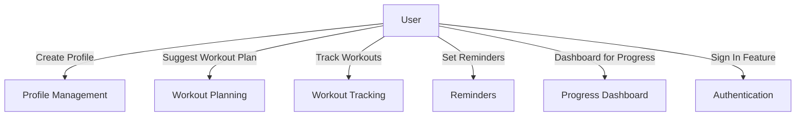
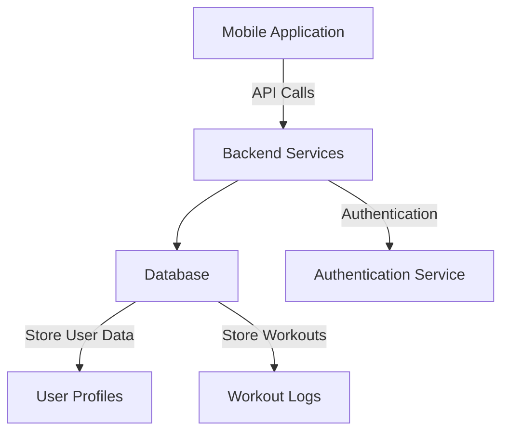
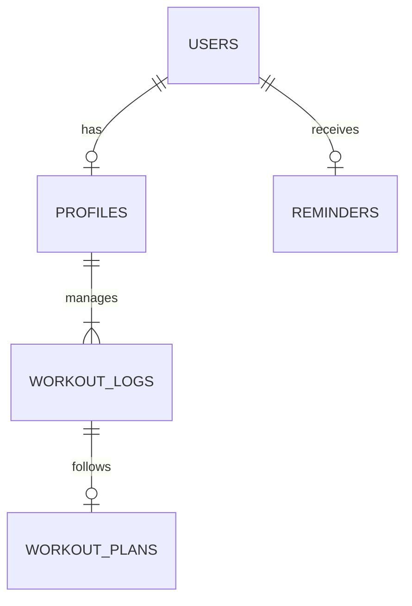
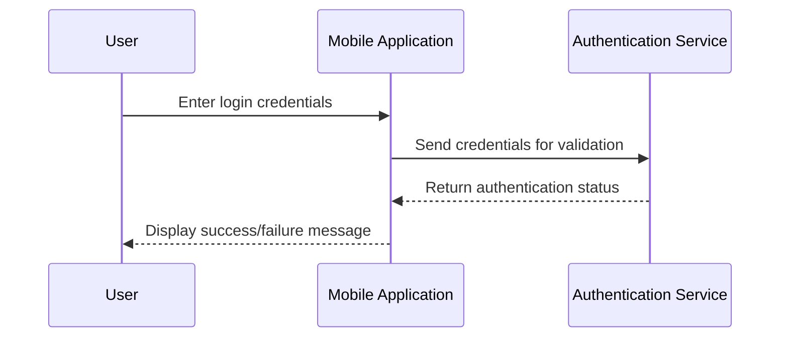

# Gym Workout Planner

> Your personal workout companion for fitness progress tracking.

A low-fidelity prototype of **Gym Workout Planner**, generated by an agentic AI project manager from a stakeholder conversation in Slack.

## Screens

- [Home](index.html) — Welcome and navigate to different features of the Gym Workout Planner.
- [Create Profile](create_profile.html) — Users can create a profile with their fitness goals and preferences.
- [Suggest Workout Plan](suggest_workout_plan.html) — The app suggests personalized workout plans based on the user's profile.
- [Track Workouts](track_workouts.html) — Log workouts and track various fitness metrics.
- [Set Reminders](set_reminders.html) — Users can set reminders to stay on track with their workouts.
- [Dashboard for Progress](dashboard.html) — View weekly progress and performance metrics.

## What this prototype fakes

- This prototype is a simplified representation of the planned system.
- No actual data persistence or backend integration is implemented.
- All interactions are simulated and do not store or update user data.

## System design

### Gym Workout Planner Use Case

This diagram outlines the main actor, the User, and the functionalities that the user can perform within the application such as creating a profile, tracking workouts, and receiving workout suggestions.

### System Architecture of Gym Workout Planner

This diagram shows the main components of the Gym Workout Planner application and their interactions, highlighting the front-end mobile application, backend services for data management, and user authentication.

### Entity-Relationship Diagram

This diagram illustrates the key entities in the Gym Workout Planner, such as User, Profile, and Workouts, and their relationships to each other, defining how user data is structured within the application.

### User Sign In Sequence Flow

This sequence diagram details the interaction between the User, the Mobile Application, and the Authentication Service during the sign-in process, illustrating the steps involved from input to successful authentication.

## Running it

Every file is static. Open `index.html`, or serve the directory with any static file server.
